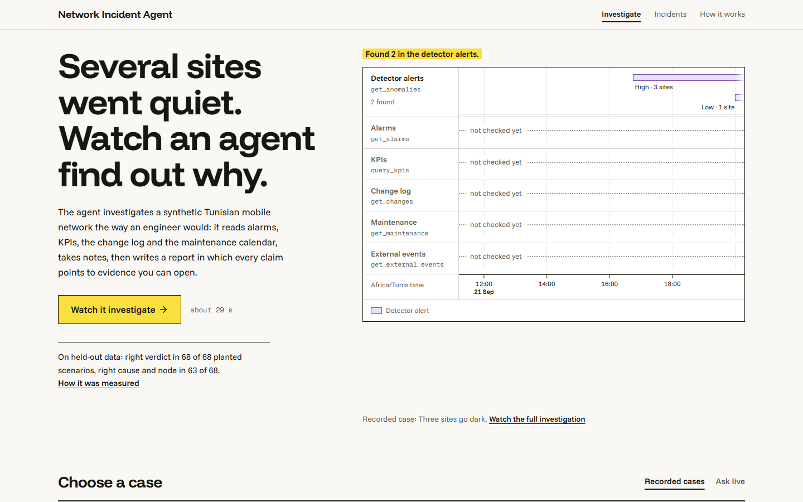
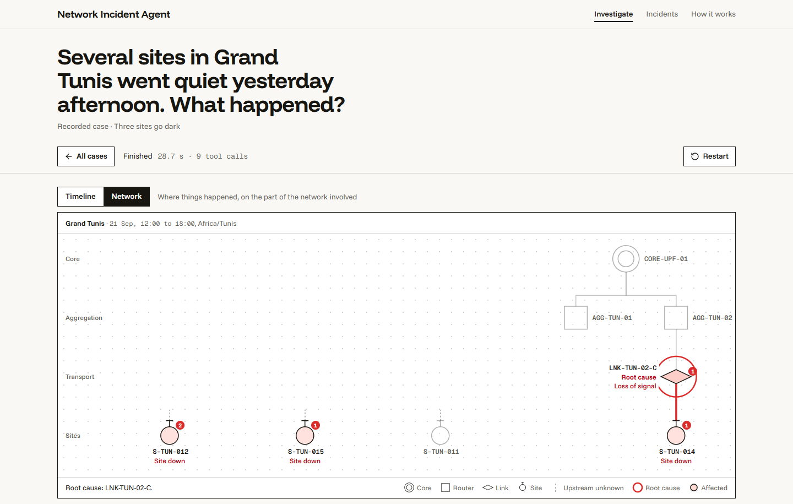
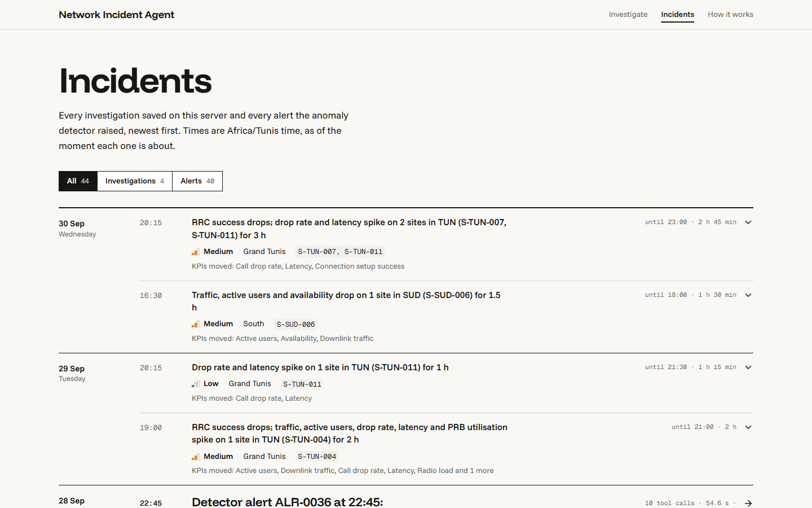
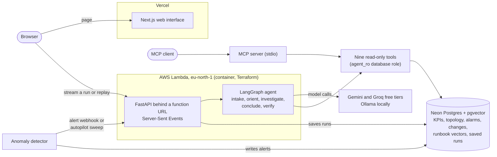

# Network Incident Agent

An agent that investigates incidents on a simulated mobile operator's network. Given a question
such as "several sites in Grand Tunis went quiet yesterday afternoon, what happened?", it reads
KPIs, detector alerts, alarms, topology, the change log, the maintenance calendar and runbooks,
finds the root cause, and writes a report in which every claim points to the evidence behind it.
It also says when it is not sure, and it can tell a real fault from planned maintenance or a
stadium crowd.

The network is synthetic and contains planted incidents with known root causes, so the agent's
answers are scored against ground truth instead of being judged by how convincing they sound.

Live site: https://network-incident-agent.vercel.app

[](https://network-incident-agent.vercel.app)

The site replays recorded investigations (no model calls), lets a visitor ask a new question live
(a few per visitor per day), lists the alerts the detector raised and the investigations they
triggered, and draws the affected part of the network for each run.

## What it does

- Investigates a question or an alert. A question comes from a user; an alert comes from the
  anomaly detector, through a webhook or a command-line sweep.
- Uses nine read-only tools: detector alerts, KPI series against a time-of-day baseline, topology,
  alarms, changes, maintenance windows, external events, runbook search and a guarded SQL query.
  Every tool sees data only up to the moment the question was asked.
- Writes a structured report: classification, root cause and node, confidence, timeline, findings
  with references, hypotheses confirmed or rejected, signals it dismissed, recommended actions.
- Checks its own report in code before showing it: references must resolve to records the run
  fetched, and look-alike traps (a maintenance window that does not cover the outage, a stadium
  event far from the symptom, a change that landed long before the fault) force a correction.
- Serves the same tools over MCP, so any MCP client can query the network directly.

| | |
|---|---|
|  |  |
| A recorded case, "Three sites go dark", on its Network tab. The agent traced the outage to a fiber link. | The Incidents page: detector alerts and the investigations they triggered. |

## Results

Everything that code can score is scored in code from the planted labels. A grader model from a
different family judges only whether each claim in a report follows from the evidence it cites.
Seed 42 is the development world, so its numbers are not used here. The worlds below were not
looked at while the prompts were written. Each run has 34 cases, one model run per case.

| What was measured | Result | Details |
|---|---|---|
| Held-out worlds (seeds 7 and 8): root cause right | 34/34 and 34/34 (31/34 and 32/34 when the exact planted node is required) | [evaluation](docs/results/evaluation.md) |
| Held-out worlds: confident and wrong | 0/34 and 0/34 | [evaluation](docs/results/evaluation.md) |
| Held-out worlds: faithfulness of claims to cited evidence | 0.91 and 0.92 (mean over claims) | [evaluation](docs/results/evaluation.md) |
| Hard world never seen before (seed 202, scenarios built around traps) | right verdict 33/34; root cause right 27/34 (79%); never inconclusive | [evaluation](docs/results/evaluation.md) |
| Hard world: confident and wrong | 2/34 | [evaluation](docs/results/evaluation.md) |
| Hard world: faithfulness | 0.88 | [evaluation](docs/results/evaluation.md) |
| Completeness check switched off (hard world) | root cause right 22/34 instead of 27/34; 4 inconclusive instead of 0; about 6k fewer tokens per case | [agent versions](docs/results/agent-versions.md) |
| Look-alike checks (hard world) | fixed 4 reports, broke none; right answers 23 to 27; confident and wrong 6 to 2 | [agent versions](docs/results/agent-versions.md) |
| Cost per investigation | median 23k to 27k tokens, 6 to 7 model calls, 7 to 8 tool calls; about $0.01 at list price, $0 on the free tier | [evaluation](docs/results/evaluation.md) |
| Anomaly detector, 3 held-out worlds | 93/93 detectable scenarios found (72/72 real incidents); precision 0.76, or 0.59 counting only real incidents; 1.4 alerts a day | [detector](docs/results/detector.md) |
| Runbook search, 69 queries | hybrid search finds a correct section in the top 5 for 84% of queries (top 1: 51%) | [retrieval](docs/results/retrieval.md) |

"Root cause right" means the verdict, the cause category and the node are all correct. It accepts
a peer node when several equal nodes share a cause, such as the sites of one configuration push.
The strict figure requires the exact node. Intervals, per-case tables and the cases the agent gets
wrong are in the evaluation page. With 34 cases per run, one case moves a rate by about 3 points.

The agent went through three versions, each measured on the same worlds before the next change.
On the seed 7 world, the first version was right on 30/34 and the third on 34/34
([agent versions](docs/results/agent-versions.md)).


Accuracy by scenario kind is in
[`evaluation-accuracy-by-kind.png`](docs/results/evaluation-accuracy-by-kind.png).

## Architecture



The browser loads the interface from Vercel and talks to the API directly. The API runs on Lambda
with response streaming, so each step of an investigation reaches the screen as it happens.

How an investigation runs (`backend/src/incident_agent/agent/`):

1. Intake. The model turns the question into a scope: a time window, regions and nodes. The window
   is clamped to the moment the question was asked.
2. Orient. Code, not the model, makes the first lookups: detector alerts for the window and the
   topology of any node the question names.
3. Investigate. Up to 6 turns, at most 3 tool calls per turn and 14 in total. The model does not
   see a chat history. Each turn it reads a bounded case file (its own notes, the evidence so far,
   the citable references), writes a note and asks for tools. If it tries to stop before checking
   the maintenance calendar, the change log and external events for the affected scope, a
   completeness gate sends it back once.
4. Conclude. The model writes the report as structured output. A malformed or cut-off report gets
   one retry, and a partial one is salvaged where possible.
5. Verify. Code checks that every reference resolves to a record the run fetched and that times
   and node ids are valid, with one repair call. Five look-alike checks compare the verdict with
   the fetched records: maintenance window coverage, the venue sites of an event, the timing of a
   change, the shared parent of a link failure, and an outage that lies inside a window. A
   contradiction gets one repair call. If it remains, confidence is set to low. A check fires only
   when a fetched record contradicts the verdict, never because a record is missing.
6. Render. The report is rendered with its evidence. The run is stored with every step, tool
   call, token count and the model that answered each step.

Model roles are set by configuration. The defaults are `gemini-3.5-flash-lite` for the agent,
with `gemini-3.1-flash-lite`, Groq `openai/gpt-oss-120b` and local Ollama `qwen3:4b` as the
fallback chain, and Groq `qwen/qwen3.8-27b` as the grader, which is from a different family than
the agent. Limits of each free tier are in [`docs/notes/llm-providers.md`](docs/notes/llm-providers.md).

## Tech stack

- Python 3.12, uv, FastAPI, LangGraph, pydantic, SQLAlchemy 2, Alembic, MCP Python SDK
- Postgres with pgvector (Neon in production, Docker locally); fastembed `bge-small-en-v1.5`
  embeddings computed locally; hybrid search (full text plus vectors, merged with reciprocal rank
  fusion)
- LLMs: Gemini and Groq free tiers, Ollama locally; responses cached on disk so evaluation re-runs
  are free and repeatable
- Next.js 16, React 19, TypeScript, Tailwind CSS 4, Vitest
- AWS Lambda container image with response streaming, Terraform, GitHub Actions (lint, types,
  tests, and an optional deploy workflow), Vercel
- ruff, mypy, pytest

## Repository layout

```
backend/                 Python package (uv project)
  src/incident_agent/
    simulator/           synthetic network, KPIs, events, planted incidents and traps
    detector/            anomaly detector and its evaluation
    rag/                 runbook chunking, embedding, search and its evaluation
    agent/               the LangGraph agent, tools, report, verification
    evals/               evaluation harness, scoring, grader, report generation
    api/                 FastAPI app, streaming, recorded demos, alert webhook, autopilot
    mcp_server/          MCP server exposing the agent's tools
    llm/                 provider factory, fallback chain, response cache
    db/                  sessions, migrations, bulk loader, publish script
frontend/                Next.js web interface
infra/                   Terraform for AWS and the deployment guide
runbooks/                markdown runbooks searched by the agent
evals/                   evaluation inputs: retrieval queries, human grades, recorded responses
docs/                    plan, results (evaluation, detector, retrieval, versions), notes, API contract
docker/, docker-compose.yml   local Postgres with pgvector
.github/workflows/       CI and deployment
```

## Quick start

Requires [uv](https://docs.astral.sh/uv/), Docker Desktop and, optionally,
[Ollama](https://ollama.com) with `qwen3:4b` pulled.

```
# 1. secrets: copy the template and fill in GEMINI_API_KEY and GROQ_API_KEY
cp .env.example .env            # PowerShell: Copy-Item .env.example .env

# 2. Postgres + pgvector on localhost:5433
docker compose up -d

# 3. Python environment and database migrations
cd backend
uv sync
uv run alembic upgrade head

# 4. Generate the synthetic network, load it, index the runbooks, run the detector
uv run python -m incident_agent.simulator build --seed 42 --out ../data/generated/seed42 --load
uv run python -m incident_agent.rag ingest
uv run python -m incident_agent.detector run

# 5. Check the database and every configured model
uv run python -m incident_agent.scripts.smoke

# 6. Ask one question from the command line
uv run python -m incident_agent.agent ask "Why did traffic drop in Grand Tunis yesterday evening?" --asked-at "2026-09-29 08:00"
```

Quality checks, from `backend/`:

```
uv run ruff check . && uv run ruff format --check . && uv run mypy src && uv run pytest
```

Add `-m db` or `-m llm` to run the tests that need Postgres or live models.

## Run the API

From `backend/`, with the database up and migrated:

```
uv run uvicorn incident_agent.api.app:app --reload     # http://localhost:8000, docs at /docs
```

- Investigations are streamed as Server-Sent Events: `POST /api/investigations/stream` runs one
  live, `POST /api/demos/{id}/stream?speed=1` replays a recording (no model call). Recordings live
  in `backend/src/incident_agent/api/demos/`; `GET /api/demos` lists them.
- Live runs call the model, so they are limited per day (`LIVE_DAILY_LIMIT`, default 20, and
  `LIVE_PER_CLIENT_DAILY_LIMIT`, default 3 per visitor) and can be switched off
  (`LIVE_ENABLED=false`). `CORS_ORIGINS` is a JSON list of allowed web origins.
- To re-record the demos from cached model responses, with no provider call:
  `LLM_CACHE_MODE=replay uv run python -m incident_agent.api.record --all`.
- The contract is `docs/api/openapi.json`. After changing an endpoint or a model, regenerate it
  with `uv run python -m incident_agent.api.openapi`; a test fails when it is out of date.

### Alert-triggered investigations

A detector alert can start an investigation on its own. The question is built from what the
detector had seen one hour into the alert, and the run is stored like a live one, so it appears on
the Incidents screen with the alert's id.

- Webhook: `POST /api/alerts/{alert_id}/investigate` with
  `Authorization: Bearer <ALERT_WEBHOOK_TOKEN>`. It runs the whole investigation inside the request
  and answers `{"created": bool, "run": {...}}`. An alert that already has a finished run, or one
  started in the last 15 minutes, is not investigated again (`created` is false). Without
  `ALERT_WEBHOOK_TOKEN` the endpoint answers 503. `ALERT_DAILY_LIMIT` (default 10) caps new runs
  per UTC day.
- Command line, for a scheduler: `uv run python -m incident_agent.api.autopilot pending` lists
  alerts without a run, `run ALR-0019` investigates one, `sweep --limit 3` investigates the newest
  pending ones and stops at the daily limit. `pending` and `--dry-run` never call a model.

## Use the tools from an MCP client

The nine read-only investigation tools are also served over MCP (stdio), for any MCP client. From
`backend/`, with the database up:

```
uv run python -m incident_agent.mcp_server                                 # data up to the dataset's now
uv run python -m incident_agent.mcp_server --asked-at "2026-09-22 08:38"   # Africa/Tunis local time
```

Every tool sees data only up to that time, as it does for the agent. Example client configuration
(adjust the path to this repository):

```json
{
  "mcpServers": {
    "network-incident-agent": {
      "command": "uv",
      "args": [
        "--directory", "/path/to/network-incident-agent/backend",
        "run", "python", "-m", "incident_agent.mcp_server"
      ]
    }
  }
}
```

To try it interactively, use the MCP Inspector:
`npx @modelcontextprotocol/inspector uv --directory backend run python -m incident_agent.mcp_server`.

## Run the web interface

With the API running (see above), from `frontend/` (Node 22):

```
cd frontend
npm install
npm run dev          # http://localhost:3000
```

It reads the API at `NEXT_PUBLIC_API_URL` (default `http://localhost:8000`); set
`NEXT_PUBLIC_REPO_URL` to show a link to this repository. To explore it without ever calling a
model, start the API with `LLM_CACHE_MODE=replay`: recorded replays never call one. Checks:
`npm run lint`, `npm run typecheck`, `npm test`, `npm run build`. More in
[`frontend/README.md`](frontend/README.md).

## Reproduce the evaluation

The commands for every run in the results are at the end of
[`docs/results/evaluation.md`](docs/results/evaluation.md). Model responses are cached on disk
(`LLM_CACHE_MODE`), so a repeated run with the same prompts replays the recorded answers. The
cache is not part of the repository: a first run calls the providers and needs the API keys, and
free-tier daily quotas spread a full run over more than one day. The detector and retrieval results
are regenerated with `uv run python -m incident_agent.detector evaluate` and
`uv run python -m incident_agent.rag evaluate`.

## Deploy

The API runs on AWS Lambda (container image, response streaming, function URL) with the data in
Neon, and the web interface on Vercel. Only always-free services are used. Setup, the image check,
rollback and teardown are in [`infra/README.md`](infra/README.md).

## Limits

- All data is simulated: one synthetic Tunisian operator with 4 regions, 48 sites and 4 core
  nodes, over 30 days. The incidents, the runbooks and the detector come from the same simulator.
  Planted effects are large compared with the noise, so results say little about real operator
  data. There are no real logs anywhere in the project.
- Each evaluation run has 34 cases and one model run per case, so intervals are wide and
  run-to-run variation is not measured. On the hard world the agent still gets 7 of 34 wrong,
  and 2 of those with high confidence.
- The anomaly detector is a batch, in-sample detector with a median and MAD baseline. A live
  version would need a trailing baseline. See [`docs/results/detector.md`](docs/results/detector.md).
- Free-tier quotas limit live use: a visitor gets 3 live investigations a day and the site as a
  whole 20. Recorded cases are not limited. If a provider is out of quota the run can fall back to
  another model, and the run records which one answered each step.
- The first request after a quiet period can take about 15 seconds while the Lambda container
  starts.
- Gemini's free tier may use prompts to improve Google's products. Send it only synthetic data.
