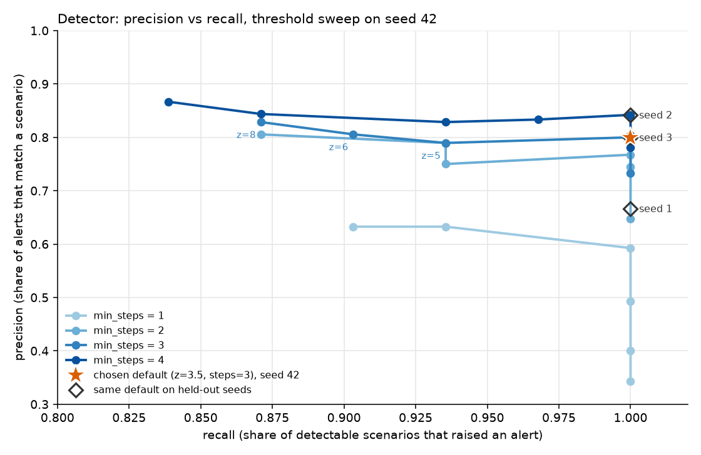

# Anomaly detector: results

Generated by `uv run python -m incident_agent.detector evaluate`. Numbers below are produced by that command; re-running it overwrites this file.

## What the detector does

It watches the network's KPI time series (traffic, users, availability, call setup success, drop rate, latency, radio load, plus DNS/UPF/AMF health) and raises an **alert** when something moves far away from its normal level for long enough. It is a simple, explainable detector, not a learned model. The point of this milestone is that we can *measure* it, because the synthetic network comes with labelled incidents.

Steps:

1. **Series.** For each site and each region, cells are combined into one series per metric (traffic and users are summed; latency, drop rate and RRC success are averaged weighted by traffic; radio load and availability are plain averages). Core nodes are monitored as they are. Cells that are down report no latency, drop or RRC value (NULL); those gaps are skipped, and the availability series carries the outage signal.
2. **Baseline.** For each series, day type (weekday, Saturday, Sunday) and 15-minute slot of the day, the detector takes the **median** of the values seen at that slot (and the two slots either side) on days of the same type. The spread is the **MAD** (median absolute deviation: the median of how far each value is from the median). Median and MAD are *robust*: a few abnormal days barely move them, which is why an incident does not hide itself.
3. **Robust z-score.** `z = (value - median) / (1.4826 * MAD + floor)`. It says how many "normal wiggles" the value is from normal. The 1.4826 factor makes MAD comparable to a standard deviation. The small per-metric floor stops near-constant series, such as availability (almost always 100), from producing huge scores on harmless changes.
4. **Anomaly.** At least `min_steps` consecutive 15-minute steps with `z` beyond `z_threshold` in a direction that matters for the metric (volume: down or up; availability, RRC success, DNS and attach success: down; latency, drop rate, radio load, DNS time: up). A single normal step inside a run is bridged. A one-step blip never fires.
5. **Alert.** Anomalies that overlap in time and are related are grouped: same site, same transport link or aggregation router, same region, or core/nationwide. Two regions with problems at the same time stay separate alerts, unless three or more regions are affected at once (then it is one nationwide alert), or DNS/AMF is affected (everything depends on those). Each alert has a score, a `low | medium | high` label and a one-sentence summary.

Defaults: `z_threshold = 3.5`, `min_steps = 3` (that is 45 minutes of sustained deviation).

## How it is scored

Terms, for a reader who has not seen them before:

- **Precision**: of the alerts raised, the share that match a planted scenario. Low precision means noisy alerts.
- **Recall**: of the scenarios the detector could possibly see, the share that got at least one matching alert. Low recall means missed incidents.
- **F1** balances the two. **F2** weights recall twice as much as precision. We care about F2 more: a missed real incident costs more than an extra alert.

Rules (code: `detector/evaluate.py`, the only place that reads ground truth):

- **Detectable scenarios** are all kinds except `alarm_storm` (an alarm flood with no KPI impact). An alert raised only because of a storm would count as a false positive; none did.
- **Red herrings count as detectable.** Planned maintenance, stadium events and the public holiday really do move the KPIs, so the detector *should* alert on them. Deciding they are not incidents is the agent's job. The `precision` below therefore counts an alert on a red herring as correct. Alerts that match a real incident only are reported as "incident precision" in `detector.json`.
- An alert **matches** a scenario if the time ranges overlap (alert vs. impact start to end) and they share scope: the alert's sites intersect the scenario's sites (links and routers are resolved to the sites behind them), or, for nationwide scenarios (DNS, public holiday), the alert is nationwide, core-level or spans several regions.
- **Delay** = alert start minus impact start, in minutes, for the earliest matching alert. Alert starts sit on the 15-minute grid, so small negative values just mean the impact began part-way through the previous step. This measures how precisely the interval starts. An online detector could only *know* after `min_steps` steps, which is the median of 43 minutes on the held-out seeds.
- **Fragmentation** = alerts per detected scenario (1.00 is ideal). **Merges** = alerts that match more than one scenario.

## Tuning protocol

The thresholds were chosen on **seed 42 only**. Seeds 1, 2 and 3 (new worlds built in memory, with new topologies, noise and scenario placement) were not used to choose anything and are the headline numbers. Seed 42 is shown for reference only; it is optimistic because it is the data the thresholds were picked on.

### Threshold sweep, seed 42



| z_threshold | min_steps | alerts | per day | precision | recall | F1 | F2 | |
|---|---|---|---|---|---|---|---|---|
| 3 | 1 | 99 | 3.3 | 0.34 | 1.00 | 0.51 | 0.72 |  |
| 3.5 | 1 | 80 | 2.7 | 0.40 | 1.00 | 0.57 | 0.77 |  |
| 4 | 1 | 67 | 2.2 | 0.49 | 1.00 | 0.66 | 0.83 |  |
| 5 | 1 | 54 | 1.8 | 0.59 | 1.00 | 0.74 | 0.88 |  |
| 6 | 1 | 49 | 1.6 | 0.63 | 0.94 | 0.75 | 0.85 |  |
| 8 | 1 | 49 | 1.6 | 0.63 | 0.90 | 0.74 | 0.83 |  |
| 3 | 2 | 51 | 1.7 | 0.65 | 1.00 | 0.79 | 0.90 |  |
| 3.5 | 2 | 43 | 1.4 | 0.74 | 1.00 | 0.85 | 0.94 |  |
| 4 | 2 | 43 | 1.4 | 0.77 | 1.00 | 0.87 | 0.94 |  |
| 5 | 2 | 40 | 1.3 | 0.75 | 0.94 | 0.83 | 0.89 |  |
| 6 | 2 | 38 | 1.3 | 0.79 | 0.94 | 0.86 | 0.90 |  |
| 8 | 2 | 36 | 1.2 | 0.81 | 0.87 | 0.84 | 0.86 |  |
| 3 | 3 | 45 | 1.5 | 0.73 | 1.00 | 0.85 | 0.93 |  |
| 3.5 | 3 | 40 | 1.3 | 0.80 | 1.00 | 0.89 | 0.95 | **chosen** |
| 4 | 3 | 40 | 1.3 | 0.80 | 1.00 | 0.89 | 0.95 |  |
| 5 | 3 | 38 | 1.3 | 0.79 | 0.94 | 0.86 | 0.90 |  |
| 6 | 3 | 36 | 1.2 | 0.81 | 0.90 | 0.85 | 0.88 |  |
| 8 | 3 | 35 | 1.2 | 0.83 | 0.87 | 0.85 | 0.86 |  |
| 3 | 4 | 41 | 1.4 | 0.78 | 1.00 | 0.88 | 0.95 |  |
| 3.5 | 4 | 38 | 1.3 | 0.84 | 1.00 | 0.91 | 0.96 |  |
| 4 | 4 | 36 | 1.2 | 0.83 | 0.97 | 0.90 | 0.94 |  |
| 5 | 4 | 35 | 1.2 | 0.83 | 0.94 | 0.88 | 0.91 |  |
| 6 | 4 | 32 | 1.1 | 0.84 | 0.87 | 0.86 | 0.87 |  |
| 8 | 4 | 30 | 1.0 | 0.87 | 0.84 | 0.85 | 0.84 |  |

Reading the table:

- Lower thresholds and shorter runs catch everything but add noise: with `min_steps = 1` the detector fires 2 to 3 alerts a day and half or more are wrong.
- Raising `min_steps` removes short noise at almost no cost on this data. Raising `z_threshold` past about 4 starts losing real scenarios. Scenarios lost first, at `min_steps = 3`:
    - z = 5: missed SCN-001 (public_holiday, medium), SCN-016 (link_degradation, easy)
    - z = 6: missed SCN-001 (public_holiday, medium), SCN-016 (link_degradation, easy), SCN-029 (link_degradation, medium)
    - z = 8: missed SCN-001 (public_holiday, medium), SCN-004 (link_degradation, easy), SCN-016 (link_degradation, easy), SCN-029 (link_degradation, medium)
- **Choice: `z_threshold = 3.5`, `min_steps = 3`.** Rule: take the best F2 (recall counts double), and among near-ties prefer the setting that confirms sooner. The best F2 on seed 42 is `z = 3.5, min_steps = 4`, but it wins by about 0.01, it needs a full hour of deviation (the shortest planted incident is about an hour, so it sits on the edge), and it fires 15 minutes later. At `min_steps = 3`, `z = 3.5` and `z = 4` give identical results on seed 42; we took the lower one because it leaves more margin for weaker signals. We accept slightly more false alerts for a faster and safer detector.
- **Alert volume is not the constraint.** The agent can investigate about 25 alerts a day; the default produces about 1.4 a day for the whole country. So we sit on the recall side of the trade-off on purpose. If volume ever matters, filter by severity (below) rather than raising the threshold.

## Results on held-out seeds

| run | alerts | per day | precision | recall | F1 | delay median (min) | delay p90 (min) | alerts per detected scenario | merged alerts |
|---|---|---|---|---|---|---|---|---|---|
| seed 1 | 48 | 1.6 | 0.67 | 1.00 | 0.80 | 0 | 14 | 1.03 | 0 |
| seed 2 | 38 | 1.3 | 0.84 | 1.00 | 0.91 | -2 | 13 | 1.03 | 0 |
| seed 3 | 40 | 1.3 | 0.80 | 1.00 | 0.89 | -2 | 17 | 1.03 | 0 |
| **held-out pooled (1, 2, 3)** | 126 | 1.4 | 0.76 | 1.00 | 0.86 | -2 | 16 | 1.03 | 0 |
| seed 42 (tuning seed, for reference) | 40 | 1.3 | 0.80 | 1.00 | 0.89 | -2 | 20 | 1.03 | 0 |

Pooled over the three held-out worlds: 93 of 93 detectable scenarios detected (72 of 72 real incidents). Precision counts red herrings as correct; counting only real incidents as correct, pooled precision is 0.59.

### Recall by scenario kind

| kind | held-out detected | held-out recall | seed 42 detected |
|---|---|---|---|
| config_push | 15/15 | 1.00 | 5/5 |
| congestion | 12/12 | 1.00 | 4/4 |
| dns_degradation | 9/9 | 1.00 | 3/3 |
| fiber_cut | 12/12 | 1.00 | 4/4 |
| link_degradation | 12/12 | 1.00 | 4/4 |
| planned_maintenance | 9/9 | 1.00 | 3/3 |
| power_outage | 12/12 | 1.00 | 4/4 |
| public_holiday | 3/3 | 1.00 | 1/1 |
| stadium_event | 9/9 | 1.00 | 3/3 |

### Recall by difficulty (held-out)

| difficulty | detected | recall |
|---|---|---|
| easy | 36/36 | 1.00 |
| hard | 21/21 | 1.00 |
| medium | 36/36 | 1.00 |

### The two deliberate overlap pairs

Each world has two pairs of scenarios placed on purpose in the same night or evening in different regions, to see whether the detector keeps them apart (the agent later has to do the same).

| seed | pair | scenario -> alerts | result |
|---|---|---|---|
| 42 | evening | SCN-028 (congestion) -> ALR-0032, ALR-0033, SCN-029 (link_degradation) -> ALR-0034 | kept apart |
| 42 | night | SCN-007 (power_outage) -> ALR-0007, SCN-008 (fiber_cut) -> ALR-0006 | kept apart |
| 1 | evening | SCN-023 (congestion) -> ALR-0030, SCN-024 (link_degradation) -> ALR-0031 | kept apart |
| 1 | night | SCN-019 (power_outage) -> ALR-0026, SCN-020 (fiber_cut) -> ALR-0025 | kept apart |
| 2 | evening | SCN-031 (congestion) -> ALR-0035, SCN-032 (link_degradation) -> ALR-0036 | kept apart |
| 2 | night | SCN-007 (power_outage) -> ALR-0012, SCN-008 (fiber_cut) -> ALR-0011 | kept apart |
| 3 | evening | SCN-020 (congestion) -> ALR-0023, ALR-0024, SCN-021 (link_degradation) -> ALR-0025 | kept apart |
| 3 | night | SCN-015 (power_outage) -> ALR-0019, SCN-016 (fiber_cut) -> ALR-0018 | kept apart |

## Forwarding only some alerts

Alerts carry a severity label from a simple score (`2*ln(1+peak z) + ln(1+hours) + ln(1+entities)`; medium from 9, high from 12). On the held-out seeds:

| forwarded | alerts per day | precision | recall | weakest kind (recall) |
|---|---|---|---|---|
| all alerts | 1.4 | 0.76 | 1.00 | config_push (1.00) |
| medium and high | 0.9 | 1.00 | 0.83 | link_degradation (0.00) |
| high only | 0.3 | 1.00 | 0.31 | congestion (0.00) |

The severity cut is a lever for later (for example, to protect the daily investigation budget). Precision rises to 1.00 at "medium and high", but recall falls because link degradations (and, at "high only", most congestions and stadium events) score below the cut. Severity here is a ranking aid, not a safe filter for dropping alerts.

## What the detector gets wrong, honestly

**False alerts.** On the held-out seeds, 30 alerts matched no scenario (30 of them labelled `low`, 0 during an alarm storm). Most are single-site latency excursions of 45 minutes to a few hours in the evening. They cluster on a handful of sites (site: count of false alerts: S-TUN-012 (10), S-SUD-003 (6), S-SFX-010 (2), S-TUN-018 (2), S-TUN-014 (2)). The worst one is the busiest site of its world in the evening (checked for seeds 1 and 2: its mean radio load between 19:00 and 22:00 is the highest of all sites). These sites run close to capacity at peak time, where the simulated latency rises steeply with load, so ordinary load noise produces big latency swings that the median/MAD baseline underestimates. They are real deviations, just not incidents. A multi-metric rule ("latency alone on one site is not enough") would remove most of them but would also hide the latency-only signal of a degraded microwave link.

**Subtle cases are caught here, but that says as much about the data as about the detector.** Recall is 100% for every kind on all four worlds at the default setting, including hard DNS degradations with no alarm. That is because the planted effects are large compared with the simulated noise (an outage is a 100% drop, a DNS degradation moves latency on every site at once). Real networks have smaller, messier effects, so do not read 100% as "this would work in production". The sweep gives a better feel: as the threshold rises, the scenarios that disappear first are the ones with the weakest signal: on seed 42 these are the public holiday (a 10 to 20% dip spread over a day) and the microwave link degradations (a latency rise on three sites). I expected hard DNS cases and short congestions to be the first casualties; they are not. The hard DNS cases move latency on every site at once, and the shortest congestion (about one hour) still gives several abnormal steps at three or four times the noise.

**Some incidents are only seen through one metric.** Link degradations (microwave rain fade) are detected through latency only and usually get a `low` severity, even though they are real incidents. Forwarding only medium and high alerts would drop recall to zero for this kind (table above).

**Alert times are rough.** The public holiday is detected only for the part of the day where traffic is clearly below a normal weekday (business hours), so the alert starts hours after the scenario does. A scenario that touches sites behind different aggregation routers (for example a two-site congestion) can give one alert per router; this is what pushes fragmentation slightly above 1.00.

**This is a batch, in-sample detector.** The baseline is computed from the same 30 days that are then scored. The median and MAD make that tolerable, but it is not what a live system could do: a live system cannot see the future days. An online version needs a baseline from a trailing history window (for example the last 4 to 8 weeks of the same day type and slot), updated on a schedule and excluding periods already flagged, and it needs a warm-up period; the detector would also have to wait `min_steps` steps before confirming an alert. With only one month of data, Saturdays and Sundays have just 4 or 5 samples per slot, which is thin.

**Pooled slots blur the baseline on steep ramps.** Each slot's baseline pools two neighbouring slots on each side. When traffic climbs quickly (morning and evening ramps), that pooling widens the MAD, so the detector is slightly less sensitive there. It is a deliberate trade for having enough samples per slot from a single month.

**Other limits.** The evaluation uses the same author's scenarios and the same simulator as the detector's test data; there are no real operator logs. Matching is generous on scope (a shared site is enough), so a large alert can match a small scenario. Only 31 to 34 scenarios per world, so one extra miss moves recall by about 3 points. Metrics are sites, regions and core nodes: nothing finer (single cells) is monitored.

## Cost

Baseline and detection for one world (48 sites, 4 regions, 4 core nodes, 2,880 steps, 7 cell metrics) take well under a second. Whole `evaluate` run including building the four worlds and the 24-point sweep: 6 s.

## Reproduce

```
cd backend
uv run python -m incident_agent.detector sweep      # seed 42 table only
uv run python -m incident_agent.detector evaluate   # held-out seeds, writes docs/results/detector.*
uv run python -m incident_agent.detector run        # score the database, replace alerts + anomalies
```
