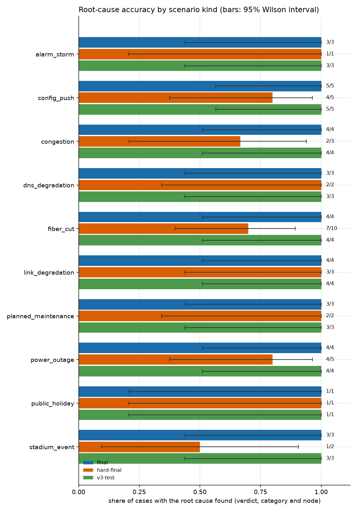
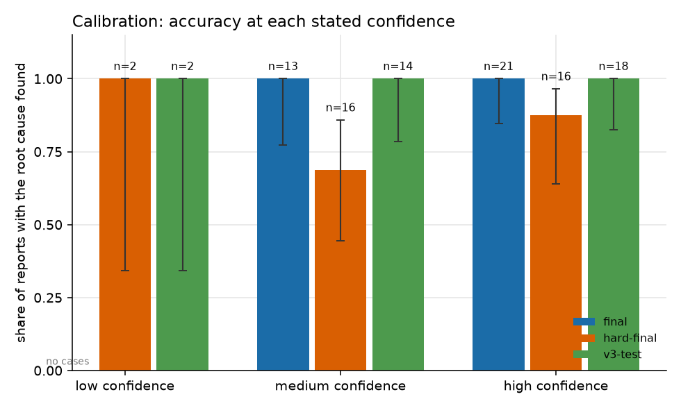
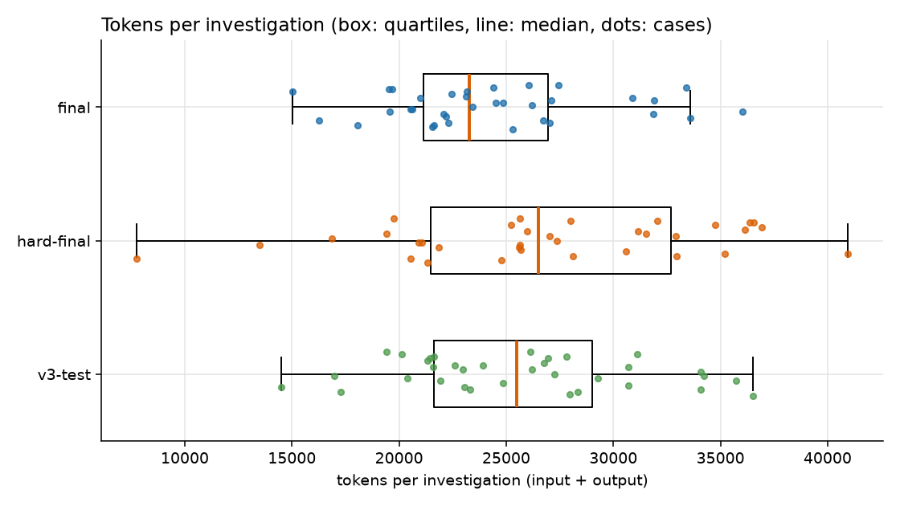

# Evaluation of the investigation agent

This page measures whether the agent finds the *right* cause of a network incident. The synthetic network contains planted incidents and red herrings with known labels, so everything below that can be scored in code is scored in code, from those labels. A grader model is used only for one thing code cannot judge: whether each claim in a report is supported by the evidence it cites.

**Seed 42 (default profile) is the dev world**: the prompts were written while looking at it, so its numbers are optimistic. Every other world is held out: built from another seed and not looked at while the prompts were written. Headline numbers come from the held-out worlds.

A **hard-profile world** has the same network and the same tables, but its scenarios are built around traps: a harmless change on the failed node, a loud coincidence next to a real regression, an outage that only looks covered by the maintenance calendar, an alarm that was never raised, two incidents in one region. Each trap has a known answer that can be derived from the data; the breakdown by trap shows which trap the agent falls into.

## Runs

| run | world | variant | model | cases scored | infrastructure errors | other model answered a step |
|---|---|---|---|---|---|---|
| final | seed 8 (test) | default | `gemini:gemini-3.5-flash-lite` | 34 of 34 | 0 | 0 |
| hard-final | seed 202 (hard, test) | default | `gemini:gemini-3.5-flash-lite` | 34 of 34 | 0 | 0 |
| v3-test | seed 7 (test) | default | `gemini:gemini-3.5-flash-lite` | 34 of 34 | 0 | 0 |
| hard-final-nogate | seed 202 (hard, test) | no-gate | `gemini:gemini-3.5-flash-lite` | 34 of 34 | 0 | 0 |

A case is one scenario with its first question. An *infrastructure error* (quota, outage, crash) is not a wrong answer: it is left out of every figure and retried on a later run. A run uses the primary model only, with no fallback chain; where the saved response of a step shows a different model answered, the case is flagged above.

## Headline


| metric | final (test) | hard-final (test) | v3-test (test) |
|---|---|---|---|
| cases scored | 34 | 34 | 34 |
| verdict correct | 34/34 (100%) [90% to 100%] | 33/34 (97%) [85% to 99%] | 34/34 (100%) [90% to 100%] |
| category correct | 34/34 (100%) [90% to 100%] | 28/34 (82%) [66% to 92%] | 34/34 (100%) [90% to 100%] |
| category in top 3 | 34/34 (100%) [90% to 100%] | 32/34 (94%) [81% to 98%] | 34/34 (100%) [90% to 100%] |
| node exact | 31/34 (91%) [77% to 97%] | 27/34 (79%) [63% to 90%] | 32/34 (94%) [81% to 98%] |
| **root cause, strict** | 31/34 (91%) [77% to 97%] | 26/34 (76%) [60% to 88%] | 32/34 (94%) [81% to 98%] |
| **root cause, lenient** | 34/34 (100%) [90% to 100%] | 27/34 (79%) [63% to 90%] | 34/34 (100%) [90% to 100%] |
| abstained | 0/34 (0%) [0% to 10%] | 0/34 (0%) [0% to 10%] | 0/34 (0%) [0% to 10%] |
| high confidence and wrong | 0/34 (0%) [0% to 10%] | 2/34 (6%) [2% to 19%] | 0/34 (0%) [0% to 10%] |

Each cell is successes/cases (share) and a 95% Wilson interval. With few cases the intervals are wide: 11 of 11 correct is compatible with a true rate as low as 74%.

## What the metrics mean

| metric | definition |
|---|---|
| verdict correct | The report's classification equals the planted one: `incident`, or for the red herrings `planned_maintenance`, `expected_event`, `no_impact`. `inconclusive` is never correct. |
| category correct | `root_cause_category` equals the planted category. |
| category in top 3 | The planted category is the stated root cause or among the first three ranked hypotheses. |
| node exact / acceptable / related / wrong | How the stated root-cause node compares with the label. `exact`: the same node. `acceptable`: a peer the label could equally have named (rules below). `related`: an ancestor or descendant of the labelled node. `wrong`: anything else, including no node. |
| root cause, strict | Verdict, category and node all correct, with node `exact`. |
| root cause, lenient | The same, with node `exact` or `acceptable`. This is the headline accuracy. |
| abstained | The report is `inconclusive`. Counted as wrong for accuracy, and shown separately. |
| high confidence and wrong | The report says `high` confidence and the lenient root cause is not right. The worst failure. |
| impact start / cause time error | Absolute difference in minutes between the reported time and the planted one. Empty when the report gives no time. |
| evidence found / cited | Of the planted evidence rows (alarms, changes, events, maintenance windows) that existed at the time of the question, the share that appeared in a tool result / that the report cites by id. |
| confounder outcome | For cases with a planted harmless look-alike (a change or alarm just before the incident): `dismissed` (listed under dismissed signals), `blamed` (cited by the confirmed hypothesis or named in the root-cause summary), `seen_ignored` (shown by a tool, never addressed), `not_seen`. |
| tool precision / recall | Distinct tools the model chose to call (the code-driven first lookups are excluded) against the tools expected for the scenario. |
| citation issues / repaired | Problems the verification step found in the first draft (unknown references, bad times, wrong node ids), and whether a repair call was needed. |
| faithfulness | Share of the report's claims that the cited evidence supports, judged by a grader model (see below). |

### Which node counts as the right one

- Peers (`acceptable`) exist only for `config_push`, `congestion`, `stadium_event`: a cause that hits several equal nodes (the sites of a pushed group, two congested sites, the sites around a venue), where the label names one of them. Any other affected node counts. A configuration push to a router is labelled with the router, so its sites are not peers.
- Every other kind has a single labelled node (the link of a fibre cut or microwave degradation, the site of a power outage or alarm storm, the DNS node, the node a maintenance window concerns): only that node is `exact`.
- The public holiday has no node. A report with no node is `exact`; naming a node is `wrong`.
- `related` means the named node is an ancestor or descendant of the label in the dependency tree (site, link, router, core). It is not counted as correct.

## Breakdown: final (test)

**By scenario kind**

| group | cases | verdict | category | root cause, strict | root cause, lenient | abstained |
|---|---|---|---|---|---|---|
| alarm_storm | 3 | 3/3 (100%) | 3/3 (100%) | 3/3 (100%) | 3/3 (100%) | 0/3 (0%) |
| config_push | 5 | 5/5 (100%) | 5/5 (100%) | 3/5 (60%) | 5/5 (100%) | 0/5 (0%) |
| congestion | 4 | 4/4 (100%) | 4/4 (100%) | 3/4 (75%) | 4/4 (100%) | 0/4 (0%) |
| dns_degradation | 3 | 3/3 (100%) | 3/3 (100%) | 3/3 (100%) | 3/3 (100%) | 0/3 (0%) |
| fiber_cut | 4 | 4/4 (100%) | 4/4 (100%) | 4/4 (100%) | 4/4 (100%) | 0/4 (0%) |
| link_degradation | 4 | 4/4 (100%) | 4/4 (100%) | 4/4 (100%) | 4/4 (100%) | 0/4 (0%) |
| planned_maintenance | 3 | 3/3 (100%) | 3/3 (100%) | 3/3 (100%) | 3/3 (100%) | 0/3 (0%) |
| power_outage | 4 | 4/4 (100%) | 4/4 (100%) | 4/4 (100%) | 4/4 (100%) | 0/4 (0%) |
| public_holiday | 1 | 1/1 (100%) | 1/1 (100%) | 1/1 (100%) | 1/1 (100%) | 0/1 (0%) |
| stadium_event | 3 | 3/3 (100%) | 3/3 (100%) | 3/3 (100%) | 3/3 (100%) | 0/3 (0%) |

**By difficulty**

| group | cases | verdict | category | root cause, strict | root cause, lenient | abstained |
|---|---|---|---|---|---|---|
| easy | 14 | 14/14 (100%) | 14/14 (100%) | 13/14 (93%) | 14/14 (100%) | 0/14 (0%) |
| hard | 7 | 7/7 (100%) | 7/7 (100%) | 6/7 (86%) | 7/7 (100%) | 0/7 (0%) |
| medium | 13 | 13/13 (100%) | 13/13 (100%) | 12/13 (92%) | 13/13 (100%) | 0/13 (0%) |

**Real incidents and red herrings**

| group | cases | verdict | category | root cause, strict | root cause, lenient | abstained |
|---|---|---|---|---|---|---|
| real incident | 24 | 24/24 (100%) | 24/24 (100%) | 21/24 (88%) | 24/24 (100%) | 0/24 (0%) |
| red herring | 10 | 10/10 (100%) | 10/10 (100%) | 10/10 (100%) | 10/10 (100%) | 0/10 (0%) |

## Breakdown: hard-final (test)

**By scenario kind**

| group | cases | verdict | category | root cause, strict | root cause, lenient | abstained |
|---|---|---|---|---|---|---|
| alarm_storm | 1 | 1/1 (100%) | 1/1 (100%) | 1/1 (100%) | 1/1 (100%) | 0/1 (0%) |
| config_push | 5 | 5/5 (100%) | 4/5 (80%) | 3/5 (60%) | 4/5 (80%) | 0/5 (0%) |
| congestion | 3 | 2/3 (67%) | 2/3 (67%) | 2/3 (67%) | 2/3 (67%) | 0/3 (0%) |
| dns_degradation | 2 | 2/2 (100%) | 2/2 (100%) | 2/2 (100%) | 2/2 (100%) | 0/2 (0%) |
| fiber_cut | 10 | 10/10 (100%) | 7/10 (70%) | 7/10 (70%) | 7/10 (70%) | 0/10 (0%) |
| link_degradation | 3 | 3/3 (100%) | 3/3 (100%) | 3/3 (100%) | 3/3 (100%) | 0/3 (0%) |
| planned_maintenance | 2 | 2/2 (100%) | 2/2 (100%) | 2/2 (100%) | 2/2 (100%) | 0/2 (0%) |
| power_outage | 5 | 5/5 (100%) | 4/5 (80%) | 4/5 (80%) | 4/5 (80%) | 0/5 (0%) |
| public_holiday | 1 | 1/1 (100%) | 1/1 (100%) | 1/1 (100%) | 1/1 (100%) | 0/1 (0%) |
| stadium_event | 2 | 2/2 (100%) | 2/2 (100%) | 1/2 (50%) | 1/2 (50%) | 0/2 (0%) |

**By difficulty**

| group | cases | verdict | category | root cause, strict | root cause, lenient | abstained |
|---|---|---|---|---|---|---|
| easy | 4 | 4/4 (100%) | 3/4 (75%) | 3/4 (75%) | 3/4 (75%) | 0/4 (0%) |
| hard | 29 | 28/29 (97%) | 24/29 (83%) | 22/29 (76%) | 23/29 (79%) | 0/29 (0%) |
| medium | 1 | 1/1 (100%) | 1/1 (100%) | 1/1 (100%) | 1/1 (100%) | 0/1 (0%) |

**Real incidents and red herrings**

| group | cases | verdict | category | root cause, strict | root cause, lenient | abstained |
|---|---|---|---|---|---|---|
| real incident | 28 | 27/28 (96%) | 22/28 (79%) | 21/28 (75%) | 22/28 (79%) | 0/28 (0%) |
| red herring | 6 | 6/6 (100%) | 6/6 (100%) | 5/6 (83%) | 5/6 (83%) | 0/6 (0%) |

**By trap** (a scenario in a hard-profile world is built around one trap)

| group | cases | verdict | category | root cause, strict | root cause, lenient | abstained |
|---|---|---|---|---|---|---|
| bad_change_loud_coincidence | 3 | 3/3 (100%) | 3/3 (100%) | 3/3 (100%) | 3/3 (100%) | 0/3 (0%) |
| change_on_root_node | 6 | 6/6 (100%) | 5/6 (83%) | 5/6 (83%) | 5/6 (83%) | 0/6 (0%) |
| congestion_on_match_day | 2 | 1/2 (50%) | 1/2 (50%) | 1/2 (50%) | 1/2 (50%) | 0/2 (0%) |
| expected_event_looks_like_fault | 2 | 2/2 (100%) | 2/2 (100%) | 1/2 (50%) | 1/2 (50%) | 0/2 (0%) |
| maintenance_with_scary_change | 2 | 2/2 (100%) | 2/2 (100%) | 2/2 (100%) | 2/2 (100%) | 0/2 (0%) |
| missing_alarm | 3 | 3/3 (100%) | 2/3 (67%) | 2/3 (67%) | 2/3 (67%) | 0/3 (0%) |
| near_miss_maintenance | 5 | 5/5 (100%) | 4/5 (80%) | 4/5 (80%) | 4/5 (80%) | 0/5 (0%) |
| no trap | 5 | 5/5 (100%) | 4/5 (80%) | 4/5 (80%) | 4/5 (80%) | 0/5 (0%) |
| two_incidents_one_region | 6 | 6/6 (100%) | 5/6 (83%) | 4/6 (67%) | 5/6 (83%) | 0/6 (0%) |

## Breakdown: v3-test (test)

**By scenario kind**

| group | cases | verdict | category | root cause, strict | root cause, lenient | abstained |
|---|---|---|---|---|---|---|
| alarm_storm | 3 | 3/3 (100%) | 3/3 (100%) | 3/3 (100%) | 3/3 (100%) | 0/3 (0%) |
| config_push | 5 | 5/5 (100%) | 5/5 (100%) | 4/5 (80%) | 5/5 (100%) | 0/5 (0%) |
| congestion | 4 | 4/4 (100%) | 4/4 (100%) | 3/4 (75%) | 4/4 (100%) | 0/4 (0%) |
| dns_degradation | 3 | 3/3 (100%) | 3/3 (100%) | 3/3 (100%) | 3/3 (100%) | 0/3 (0%) |
| fiber_cut | 4 | 4/4 (100%) | 4/4 (100%) | 4/4 (100%) | 4/4 (100%) | 0/4 (0%) |
| link_degradation | 4 | 4/4 (100%) | 4/4 (100%) | 4/4 (100%) | 4/4 (100%) | 0/4 (0%) |
| planned_maintenance | 3 | 3/3 (100%) | 3/3 (100%) | 3/3 (100%) | 3/3 (100%) | 0/3 (0%) |
| power_outage | 4 | 4/4 (100%) | 4/4 (100%) | 4/4 (100%) | 4/4 (100%) | 0/4 (0%) |
| public_holiday | 1 | 1/1 (100%) | 1/1 (100%) | 1/1 (100%) | 1/1 (100%) | 0/1 (0%) |
| stadium_event | 3 | 3/3 (100%) | 3/3 (100%) | 3/3 (100%) | 3/3 (100%) | 0/3 (0%) |

**By difficulty**

| group | cases | verdict | category | root cause, strict | root cause, lenient | abstained |
|---|---|---|---|---|---|---|
| easy | 14 | 14/14 (100%) | 14/14 (100%) | 13/14 (93%) | 14/14 (100%) | 0/14 (0%) |
| hard | 7 | 7/7 (100%) | 7/7 (100%) | 7/7 (100%) | 7/7 (100%) | 0/7 (0%) |
| medium | 13 | 13/13 (100%) | 13/13 (100%) | 12/13 (92%) | 13/13 (100%) | 0/13 (0%) |

**Real incidents and red herrings**

| group | cases | verdict | category | root cause, strict | root cause, lenient | abstained |
|---|---|---|---|---|---|---|
| real incident | 24 | 24/24 (100%) | 24/24 (100%) | 22/24 (92%) | 24/24 (100%) | 0/24 (0%) |
| red herring | 10 | 10/10 (100%) | 10/10 (100%) | 10/10 (100%) | 10/10 (100%) | 0/10 (0%) |



## Confidence and calibration

A report states `low`, `medium` or `high` confidence. If the stated confidence means anything, accuracy should rise with it. Code also lowers some confidences after the fact (for example `high` needs two kinds of evidence and the look-alike checks), so the level is partly mechanical.

| run | low | medium | high | high confidence and wrong |
|---|---|---|---|---|
| final | - | 13/13 (100%) | 21/21 (100%) | 0/21 (0%) [0% to 15%] |
| hard-final | 2/2 (100%) | 11/16 (69%) | 14/16 (88%) | 2/16 (12%) [3% to 36%] |
| v3-test | 2/2 (100%) | 14/14 (100%) | 18/18 (100%) | 0/18 (0%) [0% to 18%] |

Cells: cases with the root cause found / reports at that confidence.



## Evidence, timing and tools

| run | evidence found | evidence cited | impact start error (min) | cause time error (min) | tool precision | tool recall |
|---|---|---|---|---|---|---|
| final | 0.87 [0.77 to 0.96] (n=33) | 0.83 [0.72 to 0.93] (n=33) | median 6, mean 19 (n=34) | median 0, mean 1 (n=34) | 0.56 [0.52 to 0.60] (n=34) | 0.73 [0.67 to 0.78] (n=34) |
| hard-final | 0.85 [0.73 to 0.94] (n=34) | 0.76 [0.65 to 0.87] (n=34) | median 9, mean 17 (n=33) | median 0, mean 39 (n=32) | 0.63 [0.57 to 0.68] (n=33) | 0.73 [0.65 to 0.80] (n=34) |
| v3-test | 0.89 [0.78 to 0.97] (n=33) | 0.85 [0.74 to 0.95] (n=33) | median 4, mean 10 (n=33) | median 0, mean 2 (n=32) | 0.54 [0.49 to 0.58] (n=34) | 0.75 [0.68 to 0.82] (n=34) |

Evidence shares are low for scenarios whose planted evidence is dozens of alarms (an alarm storm): the agent sees a summary and a few rows by design. Means carry a bootstrap 95% interval.

| run | confounder outcomes | repaired reports | citation problems per report | node matches |
|---|---|---|---|---|
| final | dismissed 3, not_seen 1, seen_ignored 1 | 4/34 (12%) | 0.06 [0.00 to 0.15] (n=34) | acceptable 3, exact 31 |
| hard-final | blamed 4, dismissed 4, not_seen 10, seen_ignored 8 | 11/34 (32%) | 0.12 [0.03 to 0.24] (n=34) | acceptable 1, exact 27, related 3, wrong 3 |
| v3-test | dismissed 4, not_seen 1 | 1/34 (3%) | 0.03 [0.00 to 0.09] (n=34) | acceptable 2, exact 32 |

## Faithfulness

| run | graded reports | mean faithfulness |
|---|---|---|
| final | 34 of 34 | 0.92 [0.89 to 0.95] |
| hard-final | 34 of 34 | 0.88 [0.86 to 0.91] |
| v3-test | 34 of 34 | 0.91 [0.89 to 0.93] |

Faithfulness is the mean over a report's claims of supported = 1, partially supported = 0.5, unsupported = 0; claims the grader could not verify are left out. It checks that a claim follows from the evidence it cites, not that the claim is true in the world.

## Cost and speed

| run | model calls (p50 / p95) | tool calls (p50 / p95) | tokens (p50 / p95) | model + tool seconds (p50 / p95) | list-price cost per case (p50 / p95) |
|---|---|---|---|---|---|
| final | 6 / 8 | 7 / 12 | 23,293 / 33,474 | 22.3 / 48.0 | $0.0124 / $0.0173 |
| hard-final | 7 / 9 | 8 / 11 | 26,516 / 36,691 | 38.5 / 85.5 | $0.0139 / $0.0206 |
| v3-test | 7 / 9 | 8 / 11 | 25,499 / 34,758 | 49.6 / 100.0 | $0.0129 / $0.0177 |

Seconds add the original latency of each model call and the tool time; they leave out the pause the runner inserts between calls to respect free-tier rate limits, and they do not depend on whether a response came from the cache.

Cost uses the list price of `gemini:gemini-3.5-flash-lite`: $0.30 per million input tokens and $2.50 per million output tokens (including thinking), standard paid tier, text input; read from https://ai.google.dev/gemini-api/docs/pricing on 2026-10-10. The runs themselves used the free tier and cost nothing.

Total at list price: final $0.4455, hard-final $0.4993, v3-test $0.4522.



## Ablations

Each variant is compared with the default agent on the cases that were scored in both runs, so the two columns describe the same cases.

| variant | against | common cases | root cause, lenient: default | root cause, lenient: variant | gained | lost | tool calls p50: default / variant | tokens p50: default / variant |
|---|---|---|---|---|---|---|---|---|
| hard-final-nogate (no-gate) | hard-final | 34 | 27/34 (79%) [63% to 90%] | 22/34 (65%) [48% to 79%] | 1 | 6 | 8.0 / 11.3 -> 7.0 / 11.0 | 26,516 / 36,691 -> 20,620 / 30,494 |

- `hard-final-nogate`: gained h202-SCN-026-q0; lost h202-SCN-008-q0, h202-SCN-013-q0, h202-SCN-014-q0, h202-SCN-016-q0, h202-SCN-020-q0, h202-SCN-032-q0.

A difference of one or two cases between runs is within the noise of a single run per case; nothing here was repeated to measure that noise.

## Effect of the look-alike checks

After the report is written, code checks it against the records the run fetched: a maintenance window must cover the outage in time and place, an event explains only its venue sites, a bad change must hit when it lands, a link failure without an alarm is placed on the shared parent, and an outage wholly inside a window is planned work. A contradiction is stated to the model, which gets one call to correct the report. The report as it stood before the checks is kept, so each run is scored twice on the same investigations.

| run | checks fired | became right | became wrong | root cause, lenient: before -> after | high confidence and wrong: before -> after |
|---|---|---|---|---|---|
| final | 2 of 34 | 2 | 0 | 32 -> 34 | 0 -> 0 |
| hard-final | 7 of 34 | 4 | 0 | 23 -> 27 | 6 -> 2 |

## Every case

### final

| case | kind | difficulty | planted | reported | node | confidence | right | evidence found / cited | tokens |
|---|---|---|---|---|---|---|---|---|---|
| s8-SCN-001-q0 | config_push | easy | bad_change @ AGG-TUN-02 | incident/bad_change @ AGG-TUN-02 | exact | high | yes | 1.00 / 1.00 | 27,454 |
| s8-SCN-002-q0 | fiber_cut | easy | transport_failure @ LNK-SAH-01-A | incident/transport_failure @ LNK-SAH-01-A | exact | medium | yes | 1.00 / 1.00 | 16,270 |
| s8-SCN-003-q0 | alarm_storm | medium | no_impact @ S-TUN-009 | no_impact/no_impact @ S-TUN-009 | exact | high | yes | 0.17 / 0.17 | 20,550 |
| s8-SCN-004-q0 | link_degradation | easy | transport_degradation @ LNK-SAH-02-A | incident/transport_degradation @ LNK-SAH-02-A | exact | high | yes | 1.00 / 1.00 | 30,905 |
| s8-SCN-005-q0 | congestion | hard | capacity @ S-TUN-013 | incident/capacity @ S-TUN-018 | acceptable | medium | yes | 1.00 / 1.00 | 33,408 |
| s8-SCN-006-q0 | planned_maintenance | hard | planned_maintenance @ LNK-TUN-01-C | planned_maintenance/planned_maintenance @ LNK-TUN-01-C | exact | high | yes | 1.00 / 1.00 | 27,043 |
| s8-SCN-007-q0 | power_outage | easy | power_failure @ S-TUN-015 | incident/power_failure @ S-TUN-015 | exact | medium | yes | 1.00 / 1.00 | 19,548 |
| s8-SCN-008-q0 | config_push | medium | bad_change @ AGG-SFX-01 | incident/bad_change @ AGG-SFX-01 | exact | high | yes | 1.00 / 1.00 | 31,905 |
| s8-SCN-009-q0 | congestion | medium | capacity @ S-TUN-015 | incident/capacity @ S-TUN-015 | exact | high | yes | 0.50 / 0.50 | 19,511 |
| s8-SCN-010-q0 | link_degradation | medium | transport_degradation @ LNK-SAH-01-B | incident/transport_degradation @ LNK-SAH-01-B | exact | medium | yes | 1.00 / 1.00 | 21,614 |
| s8-SCN-011-q0 | dns_degradation | easy | core_degradation @ CORE-DNS-01 | incident/core_degradation @ CORE-DNS-01 | exact | high | yes | 1.00 / 1.00 | 22,076 |
| s8-SCN-012-q0 | stadium_event | hard | expected_event @ S-TUN-001 | expected_event/expected_event @ S-TUN-001 | exact | high | yes | 1.00 / 1.00 | 24,837 |
| s8-SCN-013-q0 | power_outage | medium | power_failure @ S-SAH-009 | incident/power_failure @ S-SAH-009 | exact | medium | yes | 1.00 / 1.00 | 23,146 |
| s8-SCN-014-q0 | fiber_cut | medium | transport_failure @ LNK-TUN-02-A | incident/transport_failure @ LNK-TUN-02-A | exact | medium | yes | 1.00 / 1.00 | 21,569 |
| s8-SCN-015-q0 | public_holiday | medium | expected_event @ - | expected_event/expected_event @ - | exact | high | yes | 1.00 / 1.00 | 22,182 |
| s8-SCN-016-q0 | config_push | easy | bad_change @ S-SUD-007 | incident/bad_change @ S-SUD-008 | acceptable | medium | yes | 1.00 / 1.00 | 26,184 |
| s8-SCN-017-q0 | stadium_event | easy | expected_event @ S-TUN-001 | expected_event/expected_event @ S-TUN-001 | exact | high | yes | 0.50 / 0.50 | 22,453 |
| s8-SCN-018-q0 | link_degradation | medium | transport_degradation @ LNK-SFX-02-B | incident/transport_degradation @ LNK-SFX-02-B | exact | high | yes | 1.00 / 1.00 | 25,283 |
| s8-SCN-019-q0 | dns_degradation | hard | core_degradation @ CORE-DNS-01 | incident/core_degradation @ CORE-DNS-01 | exact | high | yes | - | 33,598 |
| s8-SCN-020-q0 | power_outage | easy | power_failure @ S-TUN-008 | incident/power_failure @ S-TUN-008 | exact | medium | yes | 1.00 / 1.00 | 23,440 |
| s8-SCN-021-q0 | config_push | medium | bad_change @ S-SAH-001 | incident/bad_change @ S-SAH-006 | acceptable | medium | yes | 1.00 / 0.33 | 23,114 |
| s8-SCN-022-q0 | alarm_storm | easy | no_impact @ S-TUN-013 | no_impact/no_impact @ S-TUN-013 | exact | high | yes | 0.10 / 0.10 | 26,058 |
| s8-SCN-023-q0 | congestion | easy | capacity @ S-SUD-008 | incident/capacity @ S-SUD-008 | exact | high | yes | 1.00 / 1.00 | 26,725 |
| s8-SCN-024-q0 | planned_maintenance | medium | planned_maintenance @ LNK-SFX-01-A | planned_maintenance/planned_maintenance @ LNK-SFX-01-A | exact | high | yes | 1.00 / 1.00 | 20,613 |
| s8-SCN-025-q0 | stadium_event | medium | expected_event @ S-TUN-001 | expected_event/expected_event @ S-TUN-001 | exact | high | yes | 0.25 / 0.25 | 20,974 |
| s8-SCN-026-q0 | fiber_cut | hard | transport_failure @ LNK-SUD-02-A | incident/transport_failure @ LNK-SUD-02-A | exact | medium | yes | 1.00 / 1.00 | 24,415 |
| s8-SCN-027-q0 | link_degradation | easy | transport_degradation @ LNK-TUN-01-B | incident/transport_degradation @ LNK-TUN-01-B | exact | medium | yes | 1.00 / 1.00 | 22,314 |
| s8-SCN-028-q0 | config_push | hard | bad_change @ S-SUD-002 | incident/bad_change @ S-SUD-002 | exact | high | yes | 1.00 / 0.50 | 36,031 |
| s8-SCN-029-q0 | dns_degradation | medium | core_degradation @ CORE-DNS-01 | incident/core_degradation @ CORE-DNS-01 | exact | medium | yes | 1.00 / 1.00 | 27,092 |
| s8-SCN-030-q0 | congestion | easy | capacity @ S-TUN-018 | incident/capacity @ S-TUN-018 | exact | high | yes | 1.00 / 1.00 | 19,658 |
| s8-SCN-031-q0 | power_outage | hard | power_failure @ S-SAH-012 | incident/power_failure @ S-SAH-012 | exact | medium | yes | 1.00 / 1.00 | 18,079 |
| s8-SCN-032-q0 | alarm_storm | easy | no_impact @ S-SUD-002 | no_impact/no_impact @ S-SUD-002 | exact | high | yes | 0.09 / 0.09 | 31,866 |
| s8-SCN-033-q0 | fiber_cut | medium | transport_failure @ LNK-TUN-02-B | incident/transport_failure @ LNK-TUN-02-B | exact | high | yes | 1.00 / 1.00 | 24,510 |
| s8-SCN-034-q0 | planned_maintenance | easy | planned_maintenance @ S-TUN-011 | planned_maintenance/planned_maintenance @ S-TUN-011 | exact | high | yes | 1.00 / 1.00 | 15,018 |

### hard-final

| case | kind | difficulty | planted | reported | node | confidence | right | evidence found / cited | tokens |
|---|---|---|---|---|---|---|---|---|---|
| h202-SCN-001-q0 | fiber_cut | hard | transport_failure @ LNK-SUD-02-B | incident/transport_failure @ LNK-SUD-02-B | exact | high | yes | 1.00 / 1.00 | 19,741 |
| h202-SCN-002-q0 | fiber_cut | hard | transport_failure @ LNK-TUN-01-C | incident/power_failure @ - | wrong | medium | NO | 1.00 / 1.00 | 40,932 |
| h202-SCN-003-q0 | public_holiday | medium | expected_event @ - | expected_event/expected_event @ - | exact | high | yes | 1.00 / 1.00 | 20,899 |
| h202-SCN-004-q0 | congestion | hard | capacity @ S-TUN-010 | incident/capacity @ S-TUN-010 | exact | high | yes | 0.33 / 0.33 | 25,989 |
| h202-SCN-005-q0 | power_outage | hard | power_failure @ S-SFX-002 | incident/power_failure @ S-SFX-002 | exact | medium | yes | 0.75 / 0.75 | 27,986 |
| h202-SCN-006-q0 | link_degradation | hard | transport_degradation @ LNK-TUN-02-C | incident/transport_degradation @ LNK-TUN-02-C | exact | medium | yes | 1.00 / 1.00 | 28,125 |
| h202-SCN-007-q0 | config_push | hard | bad_change @ S-TUN-004 | incident/bad_change @ S-TUN-004 | exact | high | yes | 1.00 / 0.62 | 25,649 |
| h202-SCN-008-q0 | planned_maintenance | hard | planned_maintenance @ LNK-SUD-02-A | planned_maintenance/planned_maintenance @ LNK-SUD-02-A | exact | high | yes | 1.00 / 1.00 | 19,432 |
| h202-SCN-009-q0 | dns_degradation | hard | core_degradation @ CORE-DNS-01 | incident/core_degradation @ CORE-DNS-01 | exact | low | yes | 0.00 / 0.00 | 36,356 |
| h202-SCN-010-q0 | fiber_cut | easy | transport_failure @ LNK-SUD-01-A | incident/transport_failure @ LNK-SUD-01-A | exact | medium | yes | 1.00 / 1.00 | 20,522 |
| h202-SCN-011-q0 | fiber_cut | hard | transport_failure @ LNK-SFX-02-A | incident/bad_change @ AGG-SFX-02 | related | medium | NO | 0.67 / 0.67 | 25,585 |
| h202-SCN-012-q0 | config_push | easy | bad_change @ S-TUN-004 | incident/transport_degradation @ LNK-TUN-02-B | related | medium | NO | 1.00 / 1.00 | 32,900 |
| h202-SCN-013-q0 | congestion | hard | capacity @ S-TUN-005 | incident/capacity @ S-TUN-005 | exact | medium | yes | 1.00 / 1.00 | 34,739 |
| h202-SCN-014-q0 | stadium_event | hard | expected_event @ S-TUN-001 | expected_event/expected_event @ S-TUN-001 | exact | high | yes | 0.25 / 0.25 | 24,782 |
| h202-SCN-015-q0 | power_outage | hard | power_failure @ S-TUN-004 | incident/power_failure @ S-TUN-004 | exact | high | yes | 1.00 / 1.00 | 25,670 |
| h202-SCN-016-q0 | power_outage | hard | power_failure @ S-SFX-010 | incident/power_failure @ S-SFX-010 | exact | high | yes | 1.00 / 1.00 | 16,855 |
| h202-SCN-017-q0 | link_degradation | hard | transport_degradation @ LNK-SAH-02-A | incident/transport_degradation @ LNK-SAH-02-A | exact | high | yes | 1.00 / 1.00 | 36,917 |
| h202-SCN-018-q0 | power_outage | hard | power_failure @ S-SAH-006 | incident/power_failure @ S-SAH-006 | exact | medium | yes | 1.00 / 1.00 | 21,339 |
| h202-SCN-019-q0 | dns_degradation | hard | core_degradation @ CORE-DNS-01 | incident/core_degradation @ CORE-DNS-01 | exact | medium | yes | 1.00 / 1.00 | 30,591 |
| h202-SCN-020-q0 | link_degradation | easy | transport_degradation @ LNK-SAH-02-B | incident/transport_degradation @ LNK-SAH-02-B | exact | medium | yes | 1.00 / 1.00 | 27,378 |
| h202-SCN-021-q0 | power_outage | hard | power_failure @ S-SFX-007 | incident/transport_failure @ LNK-SFX-01-B | related | high | NO | 1.00 / 0.67 | 36,139 |
| h202-SCN-022-q0 | fiber_cut | hard | transport_failure @ LNK-SFX-02-A | incident/transport_failure @ LNK-SFX-02-A | exact | high | yes | 1.00 / 1.00 | 25,654 |
| h202-SCN-023-q0 | fiber_cut | hard | transport_failure @ LNK-SFX-01-B | incident/transport_failure @ LNK-SFX-01-B | exact | high | yes | 1.00 / 1.00 | 35,187 |
| h202-SCN-024-q0 | congestion | hard | capacity @ S-TUN-010 | expected_event/expected_event @ S-TUN-001 | wrong | medium | NO | 0.00 / 0.00 | 21,078 |
| h202-SCN-025-q0 | fiber_cut | hard | transport_failure @ LNK-TUN-01-B | incident/transport_failure @ LNK-TUN-01-B | exact | medium | yes | 1.00 / 1.00 | 31,163 |
| h202-SCN-026-q0 | stadium_event | hard | expected_event @ S-TUN-001 | expected_event/expected_event @ - | wrong | high | NO | 1.00 / 0.50 | 32,041 |
| h202-SCN-027-q0 | config_push | hard | bad_change @ S-SUD-002 | incident/bad_change @ S-SUD-002 | exact | high | yes | 1.00 / 0.60 | 32,956 |
| h202-SCN-028-q0 | planned_maintenance | hard | planned_maintenance @ S-SAH-010 | planned_maintenance/planned_maintenance @ S-SAH-010 | exact | high | yes | 1.00 / 1.00 | 13,485 |
| h202-SCN-029-q0 | fiber_cut | hard | transport_failure @ LNK-TUN-01-A | incident/transport_failure @ LNK-TUN-01-A | exact | medium | yes | 1.00 / 1.00 | 31,518 |
| h202-SCN-030-q0 | fiber_cut | hard | transport_failure @ LNK-SAH-01-B | incident/transport_degradation @ LNK-SAH-01-B | exact | medium | NO | 0.75 / 0.75 | 36,570 |
| h202-SCN-031-q0 | alarm_storm | easy | no_impact @ S-SUD-007 | no_impact/no_impact @ S-SUD-007 | exact | low | yes | 0.00 / 0.00 | 7,768 |
| h202-SCN-032-q0 | config_push | hard | bad_change @ S-TUN-007 | incident/bad_change @ S-TUN-007 | exact | high | yes | 1.00 / 0.43 | 21,834 |
| h202-SCN-033-q0 | fiber_cut | hard | transport_failure @ LNK-SAH-01-A | incident/transport_failure @ LNK-SAH-01-A | exact | medium | yes | 1.00 / 1.00 | 27,044 |
| h202-SCN-034-q0 | config_push | hard | bad_change @ S-SAH-003 | incident/bad_change @ S-SAH-010 | acceptable | medium | yes | 1.00 / 0.38 | 25,241 |

### v3-test

| case | kind | difficulty | planted | reported | node | confidence | right | evidence found / cited | tokens |
|---|---|---|---|---|---|---|---|---|---|
| s7-SCN-001-q0 | config_push | hard | bad_change @ AGG-SFX-01 | incident/bad_change @ AGG-SFX-01 | exact | medium | yes | 1.00 / 0.50 | 26,139 |
| s7-SCN-002-q0 | power_outage | medium | power_failure @ S-SUD-001 | incident/power_failure @ S-SUD-001 | exact | medium | yes | 1.00 / 1.00 | 14,484 |
| s7-SCN-003-q0 | fiber_cut | medium | transport_failure @ LNK-SAH-02-A | incident/transport_failure @ LNK-SAH-02-A | exact | medium | yes | 1.00 / 1.00 | 16,979 |
| s7-SCN-004-q0 | congestion | easy | capacity @ S-SAH-008 | incident/capacity @ S-SAH-008 | exact | high | yes | 1.00 / 1.00 | 23,905 |
| s7-SCN-005-q0 | dns_degradation | medium | core_degradation @ CORE-DNS-01 | incident/core_degradation @ CORE-DNS-01 | exact | high | yes | 1.00 / 1.00 | 31,097 |
| s7-SCN-006-q0 | link_degradation | easy | transport_degradation @ LNK-SFX-01-A | incident/transport_degradation @ LNK-SFX-01-A | exact | medium | yes | 1.00 / 1.00 | 34,081 |
| s7-SCN-007-q0 | fiber_cut | hard | transport_failure @ LNK-SFX-02-A | incident/transport_failure @ LNK-SFX-02-A | exact | medium | yes | 1.00 / 1.00 | 29,261 |
| s7-SCN-008-q0 | power_outage | easy | power_failure @ S-TUN-015 | incident/power_failure @ S-TUN-015 | exact | medium | yes | 1.00 / 1.00 | 30,696 |
| s7-SCN-009-q0 | planned_maintenance | medium | planned_maintenance @ LNK-TUN-02-C | planned_maintenance/planned_maintenance @ LNK-TUN-02-C | exact | high | yes | 1.00 / 1.00 | 27,796 |
| s7-SCN-010-q0 | config_push | medium | bad_change @ AGG-SUD-01 | incident/bad_change @ AGG-SUD-01 | exact | medium | yes | 1.00 / 0.67 | 28,327 |
| s7-SCN-011-q0 | stadium_event | easy | expected_event @ S-TUN-001 | expected_event/expected_event @ S-TUN-001 | exact | high | yes | 1.00 / 1.00 | 21,938 |
| s7-SCN-012-q0 | link_degradation | easy | transport_degradation @ LNK-SUD-02-B | incident/transport_degradation @ LNK-SUD-02-B | exact | high | yes | 1.00 / 1.00 | 26,212 |
| s7-SCN-013-q0 | congestion | easy | capacity @ S-TUN-005 | incident/capacity @ S-TUN-005 | exact | high | yes | 1.00 / 1.00 | 21,438 |
| s7-SCN-014-q0 | alarm_storm | medium | no_impact @ S-SUD-003 | no_impact/no_impact @ S-SUD-003 | exact | low | yes | 0.17 / 0.17 | 27,980 |
| s7-SCN-015-q0 | planned_maintenance | easy | planned_maintenance @ S-SFX-005 | planned_maintenance/planned_maintenance @ S-SFX-005 | exact | high | yes | 1.00 / 1.00 | 24,859 |
| s7-SCN-016-q0 | power_outage | hard | power_failure @ S-TUN-008 | incident/power_failure @ S-TUN-008 | exact | high | yes | 1.00 / 1.00 | 34,071 |
| s7-SCN-017-q0 | fiber_cut | medium | transport_failure @ LNK-SAH-01-A | incident/transport_failure @ LNK-SAH-01-A | exact | medium | yes | 1.00 / 1.00 | 21,321 |
| s7-SCN-018-q0 | config_push | easy | bad_change @ S-SFX-001 | incident/bad_change @ S-SFX-009 | acceptable | medium | yes | 1.00 / 1.00 | 36,499 |
| s7-SCN-019-q0 | congestion | hard | capacity @ S-SFX-002 | incident/capacity @ S-SFX-002 | exact | high | yes | 1.00 / 1.00 | 30,709 |
| s7-SCN-020-q0 | stadium_event | hard | expected_event @ S-TUN-001 | expected_event/expected_event @ S-TUN-001 | exact | high | yes | 1.00 / 1.00 | 27,247 |
| s7-SCN-021-q0 | link_degradation | medium | transport_degradation @ LNK-TUN-02-A | incident/transport_degradation @ LNK-TUN-02-A | exact | high | yes | 1.00 / 1.00 | 26,758 |
| s7-SCN-022-q0 | alarm_storm | easy | no_impact @ S-TUN-003 | no_impact/no_impact @ S-TUN-003 | exact | high | yes | 0.09 / 0.09 | 19,395 |
| s7-SCN-023-q0 | planned_maintenance | hard | planned_maintenance @ LNK-SAH-01-B | planned_maintenance/planned_maintenance @ LNK-SAH-01-B | exact | high | yes | 1.00 / 1.00 | 23,044 |
| s7-SCN-024-q0 | config_push | medium | bad_change @ AGG-TUN-01 | incident/bad_change @ AGG-TUN-01 | exact | high | yes | 1.00 / 1.00 | 34,228 |
| s7-SCN-025-q0 | power_outage | easy | power_failure @ S-SFX-010 | incident/power_failure @ S-SFX-010 | exact | medium | yes | 1.00 / 1.00 | 22,595 |
| s7-SCN-026-q0 | public_holiday | medium | expected_event @ - | expected_event/expected_event @ - | exact | high | yes | 1.00 / 1.00 | 20,129 |
| s7-SCN-027-q0 | dns_degradation | easy | core_degradation @ CORE-DNS-01 | incident/core_degradation @ CORE-DNS-01 | exact | high | yes | 1.00 / 1.00 | 23,305 |
| s7-SCN-028-q0 | fiber_cut | easy | transport_failure @ LNK-TUN-02-B | incident/transport_failure @ LNK-TUN-02-B | exact | medium | yes | 1.00 / 1.00 | 20,381 |
| s7-SCN-029-q0 | congestion | medium | capacity @ S-SAH-003 | incident/capacity @ S-SAH-011 | acceptable | medium | yes | 0.00 / 0.00 | 21,599 |
| s7-SCN-030-q0 | link_degradation | medium | transport_degradation @ LNK-SUD-02-A | incident/transport_degradation @ LNK-SUD-02-A | exact | medium | yes | 1.00 / 1.00 | 21,635 |
| s7-SCN-031-q0 | alarm_storm | easy | no_impact @ S-SUD-004 | no_impact/no_impact @ S-SUD-004 | exact | low | yes | 0.10 / 0.10 | 17,258 |
| s7-SCN-032-q0 | config_push | easy | bad_change @ AGG-SFX-01 | incident/bad_change @ AGG-SFX-01 | exact | medium | yes | 1.00 / 0.67 | 35,743 |
| s7-SCN-033-q0 | stadium_event | medium | expected_event @ S-TUN-001 | expected_event/expected_event @ S-TUN-001 | exact | high | yes | 1.00 / 1.00 | 22,984 |
| s7-SCN-034-q0 | dns_degradation | hard | core_degradation @ CORE-DNS-01 | incident/core_degradation @ CORE-DNS-01 | exact | high | yes | - | 26,956 |

### hard-final-nogate

| case | kind | difficulty | planted | reported | node | confidence | right | evidence found / cited | tokens |
|---|---|---|---|---|---|---|---|---|---|
| h202-SCN-001-q0 | fiber_cut | hard | transport_failure @ LNK-SUD-02-B | incident/transport_failure @ LNK-SUD-02-B | exact | high | yes | 1.00 / 1.00 | 19,741 |
| h202-SCN-002-q0 | fiber_cut | hard | transport_failure @ LNK-TUN-01-C | incident/power_failure @ S-TUN-017 | related | low | NO | 1.00 / 1.00 | 28,811 |
| h202-SCN-003-q0 | public_holiday | medium | expected_event @ - | expected_event/expected_event @ - | exact | high | yes | 1.00 / 1.00 | 20,899 |
| h202-SCN-004-q0 | congestion | hard | capacity @ S-TUN-010 | incident/capacity @ S-TUN-010 | exact | medium | yes | 0.33 / 0.33 | 16,410 |
| h202-SCN-005-q0 | power_outage | hard | power_failure @ S-SFX-002 | incident/power_failure @ S-SFX-002 | exact | medium | yes | 0.75 / 0.75 | 22,537 |
| h202-SCN-006-q0 | link_degradation | hard | transport_degradation @ LNK-TUN-02-C | incident/transport_degradation @ LNK-TUN-02-C | exact | medium | yes | 1.00 / 1.00 | 23,226 |
| h202-SCN-007-q0 | config_push | hard | bad_change @ S-TUN-004 | incident/bad_change @ S-TUN-004 | exact | medium | yes | 1.00 / 0.62 | 16,184 |
| h202-SCN-008-q0 | planned_maintenance | hard | planned_maintenance @ LNK-SUD-02-A | inconclusive/unknown @ - | wrong | low | NO | 0.00 / 0.00 | 9,074 |
| h202-SCN-009-q0 | dns_degradation | hard | core_degradation @ CORE-DNS-01 | incident/core_degradation @ CORE-DNS-01 | exact | medium | yes | 0.00 / 0.00 | 22,197 |
| h202-SCN-010-q0 | fiber_cut | easy | transport_failure @ LNK-SUD-01-A | incident/transport_failure @ LNK-SUD-01-A | exact | medium | yes | 1.00 / 1.00 | 15,907 |
| h202-SCN-011-q0 | fiber_cut | hard | transport_failure @ LNK-SFX-02-A | incident/bad_change @ AGG-SFX-02 | related | medium | NO | 0.67 / 0.67 | 20,340 |
| h202-SCN-012-q0 | config_push | easy | bad_change @ S-TUN-004 | incident/transport_degradation @ LNK-TUN-02-B | related | medium | NO | 1.00 / 1.00 | 32,900 |
| h202-SCN-013-q0 | congestion | hard | capacity @ S-TUN-005 | inconclusive/unknown @ - | wrong | low | NO | 1.00 / 1.00 | 24,409 |
| h202-SCN-014-q0 | stadium_event | hard | expected_event @ S-TUN-001 | expected_event/expected_event @ - | wrong | high | NO | 0.25 / 0.25 | 15,510 |
| h202-SCN-015-q0 | power_outage | hard | power_failure @ S-TUN-004 | incident/power_failure @ S-TUN-004 | exact | medium | yes | 1.00 / 1.00 | 15,509 |
| h202-SCN-016-q0 | power_outage | hard | power_failure @ S-SFX-010 | inconclusive/unknown @ - | wrong | low | NO | 0.00 / 0.00 | 5,362 |
| h202-SCN-017-q0 | link_degradation | hard | transport_degradation @ LNK-SAH-02-A | incident/transport_degradation @ LNK-SAH-02-A | exact | medium | yes | 1.00 / 1.00 | 21,358 |
| h202-SCN-018-q0 | power_outage | hard | power_failure @ S-SAH-006 | incident/power_failure @ S-SAH-006 | exact | medium | yes | 1.00 / 1.00 | 16,559 |
| h202-SCN-019-q0 | dns_degradation | hard | core_degradation @ CORE-DNS-01 | incident/core_degradation @ CORE-DNS-01 | exact | medium | yes | 0.00 / 0.00 | 6,292 |
| h202-SCN-020-q0 | link_degradation | easy | transport_degradation @ LNK-SAH-02-B | incident/core_degradation @ CORE-DNS-01 | wrong | medium | NO | 1.00 / 1.00 | 24,582 |
| h202-SCN-021-q0 | power_outage | hard | power_failure @ S-SFX-007 | incident/transport_failure @ LNK-SFX-01-B | related | medium | NO | 1.00 / 1.00 | 26,405 |
| h202-SCN-022-q0 | fiber_cut | hard | transport_failure @ LNK-SFX-02-A | incident/transport_failure @ LNK-SFX-02-A | exact | medium | yes | 1.00 / 1.00 | 11,578 |
| h202-SCN-023-q0 | fiber_cut | hard | transport_failure @ LNK-SFX-01-B | incident/transport_failure @ LNK-SFX-01-B | exact | medium | yes | 1.00 / 1.00 | 29,942 |
| h202-SCN-024-q0 | congestion | hard | capacity @ S-TUN-010 | expected_event/expected_event @ S-TUN-001 | wrong | high | NO | 0.00 / 0.00 | 11,435 |
| h202-SCN-025-q0 | fiber_cut | hard | transport_failure @ LNK-TUN-01-B | incident/transport_failure @ LNK-TUN-01-B | exact | medium | yes | 1.00 / 1.00 | 25,481 |
| h202-SCN-026-q0 | stadium_event | hard | expected_event @ S-TUN-001 | expected_event/expected_event @ S-TUN-001 | exact | high | yes | 1.00 / 0.75 | 26,432 |
| h202-SCN-027-q0 | config_push | hard | bad_change @ S-SUD-002 | incident/bad_change @ S-SUD-002 | exact | medium | yes | 1.00 / 0.60 | 22,940 |
| h202-SCN-028-q0 | planned_maintenance | hard | planned_maintenance @ S-SAH-010 | planned_maintenance/planned_maintenance @ S-SAH-010 | exact | high | yes | 1.00 / 1.00 | 10,194 |
| h202-SCN-029-q0 | fiber_cut | hard | transport_failure @ LNK-TUN-01-A | incident/transport_failure @ LNK-TUN-01-A | exact | medium | yes | 1.00 / 1.00 | 31,518 |
| h202-SCN-030-q0 | fiber_cut | hard | transport_failure @ LNK-SAH-01-B | incident/transport_degradation @ LNK-SAH-01-B | exact | medium | NO | 0.75 / 0.75 | 26,578 |
| h202-SCN-031-q0 | alarm_storm | easy | no_impact @ S-SUD-007 | no_impact/no_impact @ S-SUD-007 | exact | low | yes | 0.00 / 0.00 | 4,996 |
| h202-SCN-032-q0 | config_push | hard | bad_change @ S-TUN-007 | inconclusive/unknown @ - | wrong | low | NO | 0.00 / 0.00 | 10,002 |
| h202-SCN-033-q0 | fiber_cut | hard | transport_failure @ LNK-SAH-01-A | incident/transport_failure @ LNK-SAH-01-A | exact | medium | yes | 1.00 / 1.00 | 21,821 |
| h202-SCN-034-q0 | config_push | hard | bad_change @ S-SAH-003 | incident/bad_change @ S-SAH-010 | acceptable | medium | yes | 1.00 / 1.00 | 14,979 |

## What the agent gets wrong

**h202-SCN-021-q0** (hard-final; power_outage, hard)

- Question: S-SFX-007 has been down since 13:25, what happened?
- Planted: incident / power_failure at S-SFX-007.
- Reported: incident / transport_failure at LNK-SFX-01-B, confidence high; node match `related`.
- The report says: Unplanned fiber link loss on LNK-SFX-01-B caused transport failure affecting S-SFX-007 and sibling sites before maintenance began.
- Planted notes: trap=two_incidents_one_region; Mains failure at S-SFX-007; the site went down when its batteries ran out. Trap: two unrelated incidents overlap in one region, so the report can mix them up. Settled by: each has its own node, alarms and KPI signature; asked about one, the report must name that one's cause and keep the other out. Overlaps in time with group 'pair-a'.

**h202-SCN-026-q0** (hard-final; stadium_event, hard)

- Question: Why did traffic jump in Grand Tunis yesterday evening?
- Planted: expected_event / expected_event at S-TUN-001.
- Reported: expected_event / expected_event at no node, confidence high; node match `wrong`.
- The report says: A major football match at Stade Olympique de Rades (EVT-005) drove a massive surge in user demand and traffic across three nearby sites.
- Planted notes: trap=expected_event_looks_like_fault; Traffic surge around the stadium caused by a scheduled event; not an incident. Trap: every venue site raises HIGH_PRB and S-TUN-002 also raises a major VSWR_HIGH alarm that clears by itself, so the venue looks faulty. Settled by: (1) availability stays at 100 % and RRC success and drop rate stay normal at all venue sites; (2) the major alarm clears within minutes and moves no KPI; (3) the external event covers the region, the evening and the venue sites, and extra traffic with high PRB is what the event explains.

**h202-SCN-024-q0** (hard-final; congestion, hard)

- Question: Why was latency high in parts of Grand Tunis yesterday evening?
- Planted: incident / capacity at S-TUN-010.
- Reported: expected_event / expected_event at S-TUN-001, confidence medium; node match `wrong`.
- The report says: High latency and traffic spikes were caused by external crowd-driven capacity congestion from a football match at Stade Olympique de Rades.
- Planted notes: trap=congestion_on_match_day; Demand surge saturated the radio resources of S-TUN-010, 7 km from the stadium; the match is real but is not the cause. Trap: a stadium event is on the calendar for the region and the evening, so a hasty investigator calls the congestion at S-TUN-010 expected. Settled by: (1) S-TUN-010 is not a venue site (near_venue is false, about 7 km away, under LNK-TUN-01-C while the venue sites hang under other links), and the event record names the venue; (2) latency and drop rate at the site are far worse than at the venue sites, whose extra capacity keeps them mild; (3) the runbook says an event far from the saturated site does not explain it.

Cases counted as correct that still had something to note:

final:

- `s8-SCN-005-q0` (congestion, hard): named S-TUN-018, a peer of the labelled node S-TUN-013; saw the confounder but neither dismissed nor blamed it.
- `s8-SCN-006-q0` (planned_maintenance, hard): needed a repair call (0 verification problem(s)).
- `s8-SCN-015-q0` (public_holiday, medium): impact start off by 450 min.
- `s8-SCN-016-q0` (config_push, easy): named S-SUD-008, a peer of the labelled node S-SUD-007.
- `s8-SCN-021-q0` (config_push, medium): named S-SAH-006, a peer of the labelled node S-SAH-001.
- `s8-SCN-028-q0` (config_push, hard): needed a repair call (0 verification problem(s)).
- `s8-SCN-032-q0` (alarm_storm, easy): needed a repair call (1 verification problem(s)).
- `s8-SCN-033-q0` (fiber_cut, medium): needed a repair call (1 verification problem(s)).

hard-final:

- `h202-SCN-004-q0` (congestion, hard): saw the confounder but neither dismissed nor blamed it.
- `h202-SCN-009-q0` (dns_degradation, hard): saw the confounder but neither dismissed nor blamed it; needed a repair call (0 verification problem(s)).
- `h202-SCN-013-q0` (congestion, hard): saw the confounder but neither dismissed nor blamed it; needed a repair call (0 verification problem(s)).
- `h202-SCN-017-q0` (link_degradation, hard): needed a repair call (1 verification problem(s)).
- `h202-SCN-019-q0` (dns_degradation, hard): saw the confounder but neither dismissed nor blamed it; needed a repair call (0 verification problem(s)).
- `h202-SCN-020-q0` (link_degradation, easy): impact start off by 245 min.
- `h202-SCN-022-q0` (fiber_cut, hard): needed a repair call (1 verification problem(s)).
- `h202-SCN-025-q0` (fiber_cut, hard): saw the confounder but neither dismissed nor blamed it; needed a repair call (0 verification problem(s)).
- `h202-SCN-029-q0` (fiber_cut, hard): needed a repair call (1 verification problem(s)).
- `h202-SCN-032-q0` (config_push, hard): saw the confounder but neither dismissed nor blamed it.
- `h202-SCN-034-q0` (config_push, hard): named S-SAH-010, a peer of the labelled node S-SAH-003.

v3-test:

- `s7-SCN-006-q0` (link_degradation, easy): impact start off by 202 min.
- `s7-SCN-016-q0` (power_outage, hard): needed a repair call (1 verification problem(s)).
- `s7-SCN-018-q0` (config_push, easy): named S-SFX-009, a peer of the labelled node S-SFX-001.
- `s7-SCN-029-q0` (congestion, medium): named S-SAH-011, a peer of the labelled node S-SAH-003.

## Limitations

- **Small samples.** There are about 34 scenarios per world, so one case moves a rate by about 3 points and the intervals are wide. Breakdowns by kind or difficulty have only a handful of cases each.
- **One run per case.** The model is run once per case; run-to-run variation is not measured.
- **Synthetic data.** The network, the incidents and the runbooks come from the same simulator. Planted effects are large compared with the noise, and there are no real operator logs.
- **Labels are conventions in places.** Where several equal nodes share a cause, the label names one; `acceptable` accepts the others, `strict` does not.
- **Evidence shares are approximate.** Evidence is matched by row id in tool results and in cited references, and an agent can reach the right conclusion from other rows.
- **Faithfulness is not truth.** The grader judges whether cited evidence supports a claim, not whether the claim is true.
- **Cost is an estimate at list price** for runs that cost nothing, and is shown only where a list price was read from the provider.

## Reproduce

```
cd backend
uv run python -m incident_agent.evals prepare --seed 8
uv run python -m incident_agent.evals run --name final --seed 8
uv run python -m incident_agent.evals score --run final
uv run python -m incident_agent.evals prepare --seed 202 --profile hard
uv run python -m incident_agent.evals run --name hard-final --seed 202 --profile hard
uv run python -m incident_agent.evals score --run hard-final
uv run python -m incident_agent.evals prepare --seed 7
uv run python -m incident_agent.evals run --name v3-test --seed 7
uv run python -m incident_agent.evals score --run v3-test
uv run python -m incident_agent.evals run --name hard-final-nogate --seed 202 --profile hard --variant no-gate
uv run python -m incident_agent.evals score --run hard-final-nogate
uv run python -m incident_agent.evals report --runs final hard-final v3-test hard-final-nogate
```
